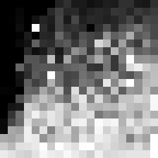

DeepInsight
===========

The DeepInsight method transforms non-image tabular data into synthetic images by spatially arranging features based on their similarity. The process begins by applying a dimensionality reduction technique (PCA, t-SNE, or Kernel PCA) to project the feature space into a two-dimensional plane. A convex hull algorithm then identifies the minimum-area rectangle containing the projected points and rotates it to align with the image axes. Finally, feature values are mapped to their corresponding pixel locations. This structured arrangement places related features close together so that convolutional neural networks can exploit local spatial dependencies.

When PCA is selected, DeepInsight can derive feature relevance from the absolute loadings of the first principal component. This relevance can be used to relocate colliding features or to calculate the value of a shared pixel as a relevance-weighted average.

Import DeepInsight
------------------
To import DeepInsight model use:

>>> from TINTOlib.deepInsight import DeepInsight
>>> model = DeepInsight(image_dim=30)

Inherited base functionality
----------------------------

DeepInsight inherits from ``ParamImageMethod`` (see Base classes), so it also provides:

* **Feature coordinates**: a feature-to-pixel mapping exported to
  ``features_positions.csv`` after ``fit``/``fit_transform``.
* **Programmatic access**: ``_get_features_mapping()`` returns the feature
  coordinates as a DataFrame once the model is fitted.
* **Shared utilities**: ``saveHyperparameters`` / ``loadHyperparameters`` and
  the standard ``fit`` / ``transform`` / ``fit_transform`` workflow.

Hyperparameters & Configuration
-------------------------------

When creating the :py:class:`DeepInsight` class, some parameters can be modified. The parameters are:

.. list-table::
   :widths: 20 40 20 20
   :header-rows: 1

   * - Parameters
     - Description
     - Default value
     - Valid values
   * - :py:data:`image_dim`
     - Order size for a square matrix image.
     - **Required**
     - integer
   * - :py:data:`problem`
     - The type of problem, defining how the images are grouped.
     - 'classification'
     - ['classification', 'unsupervised', 'regression']
   * - :py:data:`transformer`
     - Preprocessing transformations like scaling, normalization, etc.
     - MinMaxScaler()
     - Scikit Learn transformers or custom implementation inheriting CustomTransformer.
   * - :py:data:`verbose`
     - Show execution details in the terminal.
     - False
     - [True, False]
   * - :py:data:`algorithm_rd`
     - Dimensionality reduction algorithm to determine feature coordinates.
     - 'PCA'
     - ['PCA', 't-SNE', 'KPCA']
   * - :py:data:`assignment_method`
     - Technique to map features to pixels.
     - 'bin'
     - str (e.g., 'bin')
   * - :py:data:`relocate`
     - Relocate features so that each pixel can represent a single feature (only if algorithm_rd is 'PCA').
     - False
     - [True, False]
   * - :py:data:`algorithm_opt`
     - Optimization algorithm applied in the pixel assignment stage.
     - 'linear_sum'
     - str (e.g., 'linear_sum')
   * - :py:data:`group_method`
     - Technique to calculate pixel values sharing multiple features.
     - 'avg'
     - ['avg', 'rev']. ``avg`` uses the arithmetic mean; ``rev`` uses a relevance-weighted mean and requires ``algorithm_rd='PCA'``.
   * - :py:data:`zoom`
     - Multiplication factor determining the size of the saved image relative to the original size.
     - 1
     - integer > 0
   * - :py:data:`format`
     - Output format using images with matplotlib with [0,255] range for pixel or using npy format.
     - 'png'
     - ['png', 'npy']
   * - :py:data:`cmap`
     - Color map to use with matplotlib.
     - 'gray'
     - 'viridis', 'plasma', 'inferno', 'magma', 'cividis', 'Greys', etc.
   * - :py:data:`random_seed`
     - Seed for reproducibility.
     - 1
     - integer

PCA relevance options
~~~~~~~~~~~~~~~~~~~~~

With ``algorithm_rd='PCA'``, the absolute loadings of the first principal component are scaled and used as feature relevance scores. Two parameters can use these scores:

* ``group_method='rev'`` computes a relevance-weighted average when multiple features occupy the same pixel.
* ``relocate=True`` uses feature relevance in the assignment cost when relocating colliding features. The assignment algorithm is selected with ``algorithm_opt``.

Code examples:

>>> model = DeepInsight(image_dim=50, algorithm_rd='t-SNE', cmap='viridis', random_seed=42)
>>> weighted_model = DeepInsight(image_dim=50, algorithm_rd='PCA', group_method='rev')
>>> relocated_model = DeepInsight(image_dim=50, algorithm_rd='PCA', relocate=True)

All the parameters that aren't specifically set will have their default values.

Functions
---------
DeepInsight has the following functions:

.. list-table::
   :widths: 20 60 20
   :header-rows: 1

   * - Function
     - Description
     - Output
   * - :py:data:`saveHyperparameters(filename)`
     - Allows to save the defined parameters.
     - .pkl file with the configuration
   * - :py:data:`loadHyperparameters(filename)`
     - Load DeepInsight configuration previously saved with :py:data:`saveHyperparameters(filename)`

       - filename: .pkl file path
     -
   * - :py:data:`fit(data)`
     - Trains the model on the tabular data. This step performs dimensionality reduction to map features to the 2D grid.

       - data: A path to a CSV file or a Pandas DataFrame containing the features and targets. The target column must be the last column.
     -
   * - :py:data:`transform(data, folder)`
     - Generates and saves synthetic images in a specified folder. Requires the model to be fitted first.

       - data: A path to a CSV file or a Pandas DataFrame containing the features and targets. The target column must be the last column.
       - folder: Path to the folder where the synthetic images will be saved.
     - Folders with synthetic images
   * - :py:data:`fit_transform(data, folder)`
     - Combines the training and image generation steps. Fits the model to the data and generates synthetic images in one step.

       - data: A path to a CSV file or a Pandas DataFrame containing the features and targets. The target column must be the last column.
       - folder: Path to the folder where the synthetic images will be saved.
     - Folders with synthetic images

- **The model must be fitted** before using the `transform` method. If the model isn't fitted, a `RuntimeError` will be raised.

Citation
--------
**Paper**: https://doi.org/10.1038/s41598-019-47765-6

**Code Repository**: https://github.com/alok-ai-lab/pyDeepInsight
